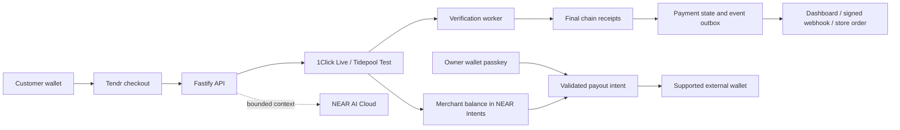

<picture>
  <source media="(prefers-color-scheme: dark)" srcset="apps/docs/images/logo-White.png">
  
</picture>

# Tendr

**One checkout. Every way to pay.**

Tendr lets a business accept supported crypto assets, choose what it receives, and pay recipients from a passkey-controlled wallet. It combines hosted and embedded checkout, payment links, contractor invoices, individual payouts and payment assistance in one API and dashboard.

A customer can pay from one network while the business receives its chosen asset in NEAR Intents. The business can then authorize a withdrawal to a supported external wallet. Tendr tracks the payment through settlement and sends signed order notifications.

[Try the playground](https://demo.usetendr.tech) · [WordPress store demo](https://wpdemo.usetendr.tech) · [Open the dashboard](https://app.usetendr.tech) · [Merchant docs](https://docs.usetendr.tech) · [Download the WooCommerce plugin](https://pay.usetendr.tech/downloads/woocommerce) · [Reviewer guide](docs/JUDGING_GUIDE.md)

**Source for review:** this README lives on `main`. The current payment, wallet, AI and invoice implementation described below is on [`deploy` at `2623e8d`](https://github.com/SonOfUri/Tendr/tree/2623e8dc8d5ee5fbf8f8b3bd31daf885ad7fdcde). Source and evidence links are pinned to that revision. [Local setup](docs/DEVELOPMENT.md#check-out-the-reviewed-application) selects it explicitly; `main` does not yet contain all of those application changes.

## The problem

Accepting crypto involves more than displaying an address. A business needs to quote a payment, handle different assets and networks, verify that the right amount reached the right recipient, update an order, and resolve partial payments or returns. Adding invoices and outgoing payments introduces another set of signing and reconciliation flows.

Tendr provides these workflows around NEAR Intents, so a merchant or application developer can integrate payment collection and settlement without implementing each chain's business logic independently.

## Try it: action → result

### 1. Explore checkout without funds or an account

Open the [playground](https://demo.usetendr.tech). Choose **E-commerce**, **Fintech**, **Gaming** or **Prediction Markets**, then start the purchase. The checkout adopts the selected product's appearance. Open **Tendr AI** to inspect the demo's route suggestions.

**Expected result:** a branded checkout with asset selection, payment instructions and a simulated completion state. This playground is UI-only; its timers and sample AI responses are not evidence of a payment or a live model call. Its addresses and React code snippets are illustrative. Use a dashboard-generated Test checkout for transfers and the published server SDK or browser embed for integration.

### 2. Try the WordPress / WooCommerce store

Open the [hosted WordPress demo](https://wpdemo.usetendr.tech), choose a product, add it to the cart and continue to checkout to inspect the Tendr payment option.

**Expected result:** a WooCommerce cart and checkout integrated with the Tendr gateway. You can inspect the store without completing a payment. For a payment, follow the mode, token and network displayed by checkout; the store demo is not automatically a Test-mode session.

### 3. Make an actual testnet payment

1. Sign in to the [dashboard](https://app.usetendr.tech), create/select a store and choose **Test**.
2. Open **Wallet**, register the dedicated Test wallet passkey and complete activation. Choose a default settlement asset.
3. Create a fixed-amount payment link and open it as the customer.
4. Fund a separate customer wallet with [Tidepool test tokens](https://app.usetidepool.tech/faucet) and that network's test gas token. Use the token and network shown by checkout.
5. Approve the transfer in the customer wallet, or follow the displayed deposit instructions.
6. Observe the session progress to **SETTLED** after receipt verification, and the resulting store Test balance. Review and sign a withdrawal with the Test wallet passkey to exercise the outgoing flow.

**Expected result:** test funds move and the API records verified settlement. These tokens have no monetary value. Test wallet setup requires a usable passkey; extra Test keys and recovery kits are not available. [Detailed Test instructions](https://github.com/SonOfUri/Tendr/blob/2623e8dc8d5ee5fbf8f8b3bd31daf885ad7fdcde/apps/docs/testing.mdx) · [Recorded end-to-end evidence](#recorded-cross-chain-payment)

### 4. Inspect the implementation without external accounts

Follow the [local setup and verification commands](docs/DEVELOPMENT.md). The focused unit suites use mocked providers; the full API/browser suites use isolated databases and simulators. The [reviewer guide](docs/JUDGING_GUIDE.md) maps each claim to implementation and tests.

## What works today

| Workflow              | Current behavior                                                                                                                                                                   |
| --------------------- | ---------------------------------------------------------------------------------------------------------------------------------------------------------------------------------- |
| Checkout              | Hosted, modal and widget experiences; customer asset selection; merchant settlement selection; receipt-based verification and signed webhooks.                                     |
| Payment links         | Fixed or open amounts; a link can override the store's default settlement token.                                                                                                   |
| Contractor invoices   | An email-verified contractor submits an itemized USD invoice without a full Tendr account. The business reviews a token quote and authorizes payment from its Live wallet.         |
| Payouts               | Individual withdrawals to supported destinations, authorized by the wallet passkey and tracked to delivery.                                                                        |
| Tendr AI              | Checkout explanations, quote-based route comparison, merchant metric summaries and unpublished theme drafts. See the model boundary below.                                         |
| Wallet access         | Separate login and wallet credentials. Live wallets support additional passkeys and a previously enabled offline recovery kit; each enabled wallet key has full signing authority. |
| WooCommerce           | Downloadable gateway plugin with store connection, checkout, order updates and refund requests. WordPress directory approval is not claimed.                                       |
| Developer integration | REST API, browser embed and the published [`@usetendr/sdk`](https://www.npmjs.com/package/@usetendr/sdk) server SDK.                                                               |

### Three different execution environments

| Environment       | What actually runs                                                                                   | What it proves                                                                               |
| ----------------- | ---------------------------------------------------------------------------------------------------- | -------------------------------------------------------------------------------------------- |
| Public playground | Frontend sample data and timers                                                                      | Appearance and interaction design.                                                           |
| Hosted Test       | Tidepool test USDC/USDT on NEAR testnet, Base Sepolia and Solana devnet                              | Testnet transfers, receipt verification, settlement and withdrawals.                         |
| Live              | Mainnet 1Click routing and native NEAR Intents wallets, when deployment and store readiness allow it | Real-money checkout and payouts; availability depends on supported routes and configuration. |

**Tidepool is an independent community testnet service, not an official NEAR Intents/1Click testnet.** Local development defaults to a separate simulator. Test and Live balances, keys and histories are scoped separately. The [six-asset allowlist](https://github.com/SonOfUri/Tendr/blob/2623e8dc8d5ee5fbf8f8b3bd31daf885ad7fdcde/packages/contracts/src/tidepool.ts) pins the test token contracts/mints; ordinary mainnet USDC/USDT are not substitutes.

## How NEAR is used

### Payment execution and merchant custody

Mainnet checkout uses 1Click to route the customer's supported asset into the merchant's chosen settlement asset. The current native merchant wallet holds its balance inside the NEAR Intents verifier. A dedicated P-256/WebAuthn credential authorizes outgoing intents; the server validates the transfer's recipient, asset, amount, nonce and expiry before relaying it.

The displayed `0x…` merchant ID identifies an account inside Intents. It is **not** a general-purpose EVM deposit address or a named `store.tendr.near` account. Named threshold-contract accounts are a separate implementation in this repository, not the default native-wallet flow.

### AI assistance with a bounded role

NEAR AI Cloud is integrated on the server for checkout help, merchant explanations and theme drafting. The checkout assistant selects from approved fact IDs; Tendr returns fresh server-written facts, including the actual payment status. Model credentials stay on the server.

Route ranking is deterministic code over provider quote previews, not an LLM choosing where funds go. “Cheapest” excludes wallet gas, and a fresh executable quote is required after selection. AI cannot sign a withdrawal, pay an invoice, approve a refund or mark an order paid. [AI implementation](https://github.com/SonOfUri/Tendr/tree/2623e8dc8d5ee5fbf8f8b3bd31daf885ad7fdcde/apps/api/src/ai) · [AI behavior and limits](https://github.com/SonOfUri/Tendr/blob/2623e8dc8d5ee5fbf8f8b3bd31daf885ad7fdcde/apps/docs/ai/overview.mdx)

## Recorded cross-chain payment

The [12 November pilot report](https://github.com/SonOfUri/Tendr/blob/2623e8dc8d5ee5fbf8f8b3bd31daf885ad7fdcde/docs/handover/2026-11-12-tidepool-testnet-pilot.md) records a full **Solana devnet → NEAR testnet merchant → Base Sepolia** flow:

| Step                | Recorded result                                        | Public evidence                                                                                                                                               |
| ------------------- | ------------------------------------------------------ | ------------------------------------------------------------------------------------------------------------------------------------------------------------- |
| Customer deposit    | 1.012184 test USDC sent on Solana devnet               | [Deposit transaction](https://explorer.solana.com/tx/4hWKtv8Gfqih3uBsb9XhqJPG4FjHdaNjCQxUhjS2H9qSeDn8KnWDJW79FHGq9G6qdf5zVvCRzngVCYgFnfdZHYjo?cluster=devnet) |
| Merchant settlement | 1.000000 test USDT credited in the NEAR verifier       | [Settlement transaction](https://testnet.nearblocks.io/txns/5M9xKKwtMCyXopwuwz4LhejnoXD2XVYHyWiu64AVrtvD)                                                     |
| Owner authorization | 1.000000 test USDT debited by a signed WebAuthn intent | [Withdrawal intent](https://testnet.nearblocks.io/txns/BxD8rWUyFsoybutxbx8BiPZLGgtkmz2dgfuqg1j8q29o)                                                          |
| External withdrawal | 0.996967 test USDC delivered on Base Sepolia           | [Payout transaction](https://sepolia.basescan.org/tx/0x8eb1c5d1d4be06aac4a6cda099c246533b7ef178192c90ec697c8261671a115e)                                      |

The report also records returned unused input, public addresses and the verification procedure. A [subsequent application smoke test](https://github.com/SonOfUri/Tendr/blob/2623e8dc8d5ee5fbf8f8b3bd31daf885ad7fdcde/docs/handover/2026-11-12-tidepool-dashboard.md#verification) exercised API registration, settlement, one `payment.succeeded` event and withdrawal. These are recorded testnet results, not a mainnet throughput benchmark or proof of external webhook delivery.

## What Tendr adds around the payment provider

- **Order correctness:** provider `SUCCESS` alone is insufficient. The worker checks finalized receipt evidence against the expected contract, recipient, asset and amount before settlement.
- **Partial-payment handling:** active underpayments expose the exact top-up remainder and deadline. Expired or superseded quotes do not accept new top-ups.
- **Return handling:** manual overpayments collect a return address afterward; connected-wallet quotes already supply one. Submitting an address is not a completed refund. The current policy retains excess below $1 after estimated return fees.
- **Business authorization:** outgoing payments bind approval to a specific quote and signed intent. Retries reconcile the saved operation rather than silently signing another transfer.
- **Invoice accounting:** line items sum as exact USD cents; the approved quote fixes the receiving token quantity. A pending payout cannot mark the invoice paid.
- **Integration boundaries:** store/mode isolation, scoped API keys, idempotent writes, signed webhooks and registered checkout domains.

[Implementation and regression-test map](docs/JUDGING_GUIDE.md#claim-to-code-map)

## Integrate

**WooCommerce:** [try the hosted store demo](https://wpdemo.usetendr.tech), or [download the ZIP](https://pay.usetendr.tech/downloads/woocommerce), install it through WordPress and connect the store. No local build is required. [Plugin guide](https://docs.usetendr.tech/integrations/woocommerce)

**TypeScript / JavaScript:** install the public server package with `npm install @usetendr/sdk`. Use it to create a checkout on your server, redirect the customer to the returned URL, and verify signed webhooks before fulfilling the order. [SDK guide](https://docs.usetendr.tech/sdks/typescript) · [Published 0.2.0 source](https://github.com/SonOfUri/Tendr/tree/usetendr-sdk-v0.2.0/packages/sdk)

The published SDK is maintained at its release tag. This deployment tree still contains the internal `@tendr/sdk` workspace; it is not the npm release source. Keep secret API keys on the server.

**Other applications:** use the [REST reference](https://docs.usetendr.tech/api-reference/overview) or [browser embed](https://docs.usetendr.tech/payments/embedded-checkout). API-key integration and dashboard wallet signing are distinct flows.

## Current limits and future work

- Individual payouts are implemented; batch payroll and autonomous agent spending are not.
- Current invoices are **contractor → business** payment requests. Business → customer collection uses payment links; a complete accounts-receivable invoicing system is not implemented.
- Shopify is an [offsite connector pilot on a separate source line](https://github.com/SonOfUri/Tendr/tree/usetendr-sdk-v0.2.0/apps/shopify), not an approved generally available Shopify payment method.
- Native wallets have one owner. Additional keys are not multisig. Test wallet recovery/key management is not enabled.
- Gas sponsorship, custom account contracts and integrator hooks have separate deployment requirements; their presence in source does not make them available on every route. Tidepool Test does not offer sponsorship or hooks.
- Blockchain payments are traceable. NEAR AI Cloud integration does not establish independent TEE attestation verification or end-to-end private inference. See [privacy boundaries](https://github.com/SonOfUri/Tendr/blob/2623e8dc8d5ee5fbf8f8b3bd31daf885ad7fdcde/apps/docs/security/privacy.mdx).
- The repository is not a security-audit certificate. Merchant KYC is not implemented; screening behavior is deployment-configured and is skipped for Tidepool test funds.

## Application source map

| Path                                                                                                                                                                                                                                       | Responsibility                                                               |
| ------------------------------------------------------------------------------------------------------------------------------------------------------------------------------------------------------------------------------------------ | ---------------------------------------------------------------------------- |
| [`apps/web`](https://github.com/SonOfUri/Tendr/tree/2623e8dc8d5ee5fbf8f8b3bd31daf885ad7fdcde/apps/web)                                                                                                                                     | Next.js dashboard, checkout, invoice portal, playground and browser embed    |
| [`apps/api`](https://github.com/SonOfUri/Tendr/tree/2623e8dc8d5ee5fbf8f8b3bd31daf885ad7fdcde/apps/api)                                                                                                                                     | Fastify API, Prisma/PostgreSQL persistence and BullMQ/Redis worker           |
| [`apps/api/src/checkout`](https://github.com/SonOfUri/Tendr/tree/2623e8dc8d5ee5fbf8f8b3bd31daf885ad7fdcde/apps/api/src/checkout)                                                                                                           | Quotes, provider adapters, payment verification, refunds and webhooks        |
| [`apps/api/src/accounts`](https://github.com/SonOfUri/Tendr/tree/2623e8dc8d5ee5fbf8f8b3bd31daf885ad7fdcde/apps/api/src/accounts)                                                                                                           | Native wallets, signing, recovery and payouts                                |
| [`apps/api/src/ai`](https://github.com/SonOfUri/Tendr/tree/2623e8dc8d5ee5fbf8f8b3bd31daf885ad7fdcde/apps/api/src/ai) / [`invoices`](https://github.com/SonOfUri/Tendr/tree/2623e8dc8d5ee5fbf8f8b3bd31daf885ad7fdcde/apps/api/src/invoices) | Bounded AI features and contractor invoice lifecycle                         |
| [`apps/woocommerce`](https://github.com/SonOfUri/Tendr/tree/2623e8dc8d5ee5fbf8f8b3bd31daf885ad7fdcde/apps/woocommerce)                                                                                                                     | Downloadable WooCommerce gateway plugin                                      |
| [`packages/contracts`](https://github.com/SonOfUri/Tendr/tree/2623e8dc8d5ee5fbf8f8b3bd31daf885ad7fdcde/packages/contracts)                                                                                                                 | Shared TypeScript schemas; this package is not on-chain code                 |
| [`onchain`](https://github.com/SonOfUri/Tendr/tree/2623e8dc8d5ee5fbf8f8b3bd31daf885ad7fdcde/onchain)                                                                                                                                       | Rust merchant/integrator contracts and EVM forwarder; separate rollout paths |
| [`apps/docs`](https://github.com/SonOfUri/Tendr/tree/2623e8dc8d5ee5fbf8f8b3bd31daf885ad7fdcde/apps/docs)                                                                                                                                   | Mintlify merchant docs and OpenAPI reference                                 |
| [`infra`](https://github.com/SonOfUri/Tendr/tree/2623e8dc8d5ee5fbf8f8b3bd31daf885ad7fdcde/infra)                                                                                                                                           | Docker and deployment infrastructure                                         |

## Hackathon scope and provenance

Prepared for review against the [NEAR HACKATHON handbook](https://nearhackathon.com/HACKATHON.md). The strongest track fit is **Real-World Money**: merchant payments, contractor invoices and stablecoin settlement. The AI assistant and gaming checkout demo do not establish autonomous businesses, private inference or a complete game economy.

The reviewed application baseline is [`deploy` at `2623e8d`](https://github.com/SonOfUri/Tendr/tree/2623e8dc8d5ee5fbf8f8b3bd31daf885ad7fdcde). Reachable history begins with [`6cb627c` on 23 October 2026](https://github.com/SonOfUri/Tendr/commit/6cb627c62c02ec3cb09db7daed931659e083a67c), inside the handbook's build window. [Initial scaffold → reviewed application diff](https://github.com/SonOfUri/Tendr/compare/6cb627c62c02ec3cb09db7daed931659e083a67c...2623e8dc8d5ee5fbf8f8b3bd31daf885ad7fdcde). The initial commit is included separately; this comparison is not a claim that its contents predate the hackathon.

[Provenance, dependencies and remaining submission metadata](docs/JUDGING_GUIDE.md#provenance-and-submission-record) distinguish Git evidence from team declarations. The final submission revision and public demo-post URL have not yet been recorded here.

## Documentation and verification

- [Reviewer guide: evidence, source and expected results](docs/JUDGING_GUIDE.md)
- [Local development and test commands](docs/DEVELOPMENT.md)
- [Dashboard frontend handover](https://github.com/SonOfUri/Tendr/blob/2623e8dc8d5ee5fbf8f8b3bd31daf885ad7fdcde/docs/handover/2026-11-02-dashboard-frontend.md)
- [AI, invoice and email handover](https://github.com/SonOfUri/Tendr/blob/2623e8dc8d5ee5fbf8f8b3bd31daf885ad7fdcde/docs/handover/2026-11-09-ai-invoices-email-design.md)
- [Tidepool integration and known test limitations](https://github.com/SonOfUri/Tendr/blob/2623e8dc8d5ee5fbf8f8b3bd31daf885ad7fdcde/docs/handover/2026-11-12-tidepool-dashboard.md)
- [CI workflow](https://github.com/SonOfUri/Tendr/blob/2623e8dc8d5ee5fbf8f8b3bd31daf885ad7fdcde/.github/workflows/ci.yml)

## License

The existing repository policy is **proprietary / hackathon use unless otherwise stated**; a root LICENSE file is pending the owner's selection. The published `@usetendr/sdk` release is MIT, the WooCommerce plugin is [GPL-2.0-or-later](https://github.com/SonOfUri/Tendr/blob/2623e8dc8d5ee5fbf8f8b3bd31daf885ad7fdcde/apps/woocommerce/LICENSE.txt), and third-party components retain their own licenses. Public source access does not change those terms.
