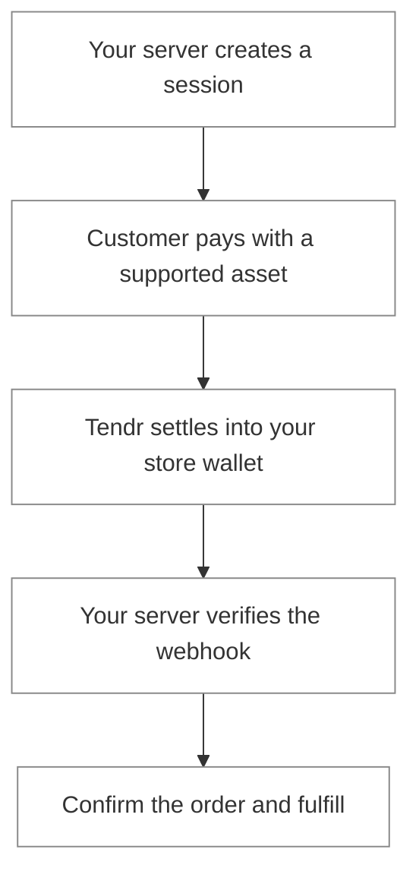

Tendr connects your store to crypto payments. Create a checkout from your server, share a payment link, or connect WooCommerce. Your customer chooses a supported token and network; Tendr routes the payment into your store's configured settlement asset.

<CardGroup cols={2}>
  <Card title="Accept your first payment" icon="bolt" href="/quickstart">
    Create a test checkout and confirm it with a signed webhook.
  </Card>
  <Card title="Connect WooCommerce" icon="store" href="/integrations/woocommerce">
    Add crypto payments to an existing WordPress store.
  </Card>
  <Card title="Share a payment link" icon="link" href="/payment-links/overview">
    Collect fixed or open amounts without writing an integration.
  </Card>
  <Card title="Pay contractor invoices" icon="file-invoice" href="/invoices/overview">
    Receive itemized invoices and approve payment from your store wallet.
  </Card>
</CardGroup>

## The payment flow

## Explore Tendr

| You want to                                    | Start here                                |
| ---------------------------------------------- | ----------------------------------------- |
| Choose the asset your business receives        | [Settlement](/payments/settlement)        |
| Understand wallet ownership and signing        | [Wallets and passkeys](/wallets/overview) |
| Explain checkout facts or business performance | [Tendr AI](/ai/overview)                  |
| Explore Shopify support                        | [Shopify pilot](/integrations/shopify)    |

<Note>
  Test mode simulates payments. Live mode moves real funds and requires an active wallet, settlement
  configuration, and live availability on the deployment. See [Test and live
  modes](/concepts/test-and-live).
</Note>
